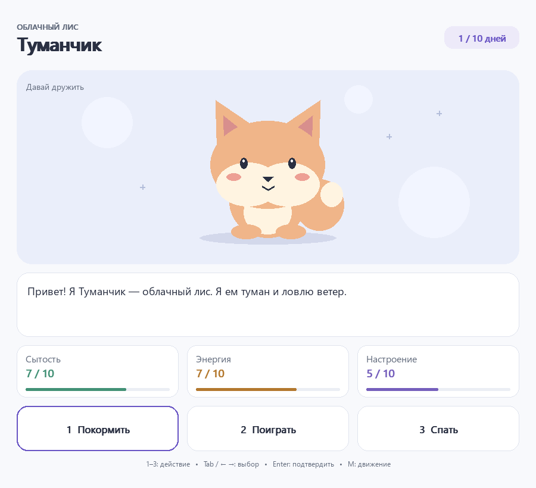

# Мой питомец · Pygame

Графическая оболочка для первых проектов на Python. Детский код остаётся
обычной последовательной программой: переменные, условия и цикл. В окне —
питомец, реплики, показатели и три кнопки. Один выбор означает один игровой день.



## Запуск после установки

В терминале VS Code, открытом в папке проекта:

```powershell
.\.venv\Scripts\python.exe main.py
```

Для кнопки **Run Python File in Terminal** выберите интерпретатор
`.venv\Scripts\python.exe` через **Python: Select Interpreter**.
Открывать и запускать нужно `main.py`.

## Установка на Windows

Проверенная конфигурация: **Python 3.12 и Pygame 2.6.1**. Подготовку выполняет
преподаватель. Pygame не входит в стандартную библиотеку Python.

1. Скачайте репозиторий через **Code → Download ZIP** и распакуйте архив.
2. Откройте скопированную папку через **File → Open Folder** в VS Code.
3. Убедитесь, что установлен Python 3.12. Команда `py -0p` покажет версии.
4. В терминале VS Code выполните по очереди, дожидаясь завершения каждой:

```powershell
py -3.12 -m venv .venv
.\.venv\Scripts\python.exe -m pip install -r requirements.txt
.\.venv\Scripts\python.exe main.py
```

Если `py -3.12` не найден, сначала установите Python 3.12 с
[python.org](https://www.python.org/downloads/). Не нужно пытаться собирать
Pygame из исходников в ходе детского занятия. Установленное здесь окружение
нельзя просто переносить на другой компьютер — создайте там новое.

## Файлы

| Файл | Для чего |
| --- | --- |
| `main.py` | Готовая графическая игра: дети меняют её содержание и правила |
| `pet_window.py` | Оболочка Pygame, которую не требуется редактировать |
| `images/` | Необязательные картинки питомца |
| `output/pdf/` | Две пошаговые методички в PDF |
| `pet_example.py` | Текстовая версия игры |
| `tests/` | Проверки для преподавателя / разработчика |

## Методички

- [Создание текстовой игры — 12 страниц](output/pdf/01_Мой_необычный_питомец.pdf)
- [Подключение графики Pygame — 3 страницы](output/pdf/02_Графический_тамагочи.pdf)

Страницы PDF сохранены изображениями: обычное выделение и копирование текста
недоступно. Распознавание текста через OCR остаётся возможным.

## Команды оболочки

```python
from pet_window import start, show, choose, say, finish

start("Пушок", "Кот с Сатурна")
say("Привет! Я люблю звёздное печенье.")
show(3, 7, 5, 1, 10)
choice = choose("Покормить", "Поиграть", "Спать")
say("Спасибо за заботу!")
finish("Наше первое приключение", "До новой встречи!")
```

- `start(name, species)` создаёт окно. Необязательные параметры:
  `image="images/pet.png"`, `color="#6955c4"`, `motion=False`.
- `show(hunger, energy, mood, day, total_days)` показывает состояние. На экране
  **сытость = 10 − голод**, остальные показатели совпадают с переменными.
  Оболочка ограничивает только отображаемые значения; правила и ограничения
  игровых переменных остаются в детском коде.
- `say(...)` собирает реплики, как `print()` собирает части сообщения. Реплики
  остаются видимыми до следующего выбора. Если они длинные, доступны прокрутка
  колёсиком и клавиши ↑/↓. Функция сама не делает паузу.
- `choose(...)` обслуживает окно и ждёт кнопку. Возвращает строки `"1"`, `"2"`,
  `"3"`. Имена кнопок можно задавать тремя строками.
- `finish(title, message)` показывает итог вместо обычных реплик, убирает
  игровые кнопки и ждёт кнопку «Завершить». Затем закрывает окно и возвращает
  управление программе. Поэтому это последняя команда игры.

Между ожиданиями пишите обычные короткие вычисления. Не ставьте `input()`,
`time.sleep()` или бесконечные циклы: пока они выполняются, окно не обрабатывает
события. События и ограничение 60 кадров/с уже находятся внутри `choose()` и
`finish()`. Потоки, собственный цикл Pygame и обработчики детям не нужны.

## Управление

- Мышь: нажать и отпустить одну кнопку.
- Цифры 1, 2, 3 (также цифровой блок): выбрать действие.
- Tab / Shift+Tab или ← / →: выделить кнопку; Enter / пробел: подтвердить.
- Колёсико / ↑ / ↓: прокрутить длинные реплики.
- M (физическая клавиша): включить / выключить покачивание и моргание.
- Esc или крестик: завершить программу без сообщения об ошибке.

Окно изменяет размер, минимальная область — 560 × 600. Короткая защита от
повторного нажатия (180 мс) предотвращает случайный расход нескольких дней.
Ни анимация, ни реальное прошедшее время не меняют игровые показатели.

## Собственные картинки

Положите `pet.png` в `images/` и перезапустите игру. Путь считается от папки
`pet_window.py`, поэтому запуск из другого рабочего каталога тоже работает.
Пропорции PNG сохраняются. Без картинки появляется встроенный лис.
Файлы `happy.png`, `hungry.png`, `tired.png`, `sleeping.png` необязательны;
подробности — в `images/README.md`.

## Проверки

```powershell
.\.venv\Scripts\python.exe -m unittest discover -s tests -v
```

Тесты используют SDL dummy (без видимого окна): проверяют выбор, события
закрытия, завершение, доступность длинных реплик, размеры, PNG и прохождение
десяти дней с разными концовками. Реальный внешний вид и клики проверяются
отдельно запуском `main.py`.
